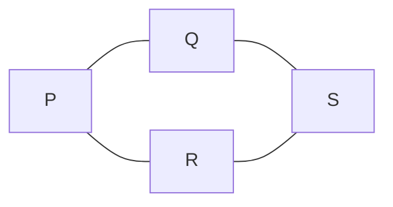

## Introduction
* This paper addresses topology design for LEO constellations: which other satellites each Starlink satellite, with only U = 4 link ports, should connect to via ISLs.
* The authors argue that +Grid (and xGrid / Motif) assume an ideal constellation. Real TLE data shows non-parallel orbits, unequal RAAN and spacing, and perigee differences, so orbital neighbours are not always the best partners. Existing improvements also optimise only the current snapshot, ignoring that satellites move at 7.66 km/s.
* They formulate an optimisation problem that jointly maximises capacity and minimises latency and link churn, and propose the DoTD algorithm, which they claim solves it optimally (it is actually a greedy heuristic; see Critique): each slot, every satellite links to the 4 candidates with the best score (current link quality plus the candidate's history), precomputed ~10 min ahead with OSPF on top.
* In simulations using real orbital data for 907 Starlink satellites, DoTD beats a Greedy baseline (current score only) and +Grid on hop count, latency, capacity and link stability.
* The paper has several flaws (inverted latency formula, unbounded history score, unproven optimality); see the Critique section.

### 他們想解決的問題
1. **埠數有限，要選對連線對象**：每顆 Starlink 衛星只有 4 個雷射埠（U = 4），卻同時看得到很多顆衛星。要連哪 4 顆，直接決定整個網路的容量、延遲和連通性。
2. **真實星座不規則，固定規則不再最佳**：+Grid、xGrid、Motif 這類方法假設軌道平行、間距相等，所以固定連「同軌道前後 + 相鄰軌道左右」。但真實 TLE 資料顯示軌道不平行、RAAN 與間距不均、近地點也不同，軌道上的「鄰居」不一定最近或最好，可能距離遠、容量低、延遲高。
3. **衛星高速移動，拓樸隨時間變化**：衛星以約 7.66 km/s 移動，最好的連線對象每隔幾秒就會改變。現有改良方法只對「當下快照」最佳化（像 Greedy），結果會頻繁換線（link churn）；論文指出換線會增加網路重新設定的成本、影響服務連續性（重新對準雷射、重算路由是背景知識，論文沒有明說）。
4. **多個目標互相拉扯**：同時要容量大、延遲低、又要少換線，三者常常衝突，例如最快的新連線可能需要拆掉一條穩定的舊連線。
5. **需要快速、可事先算好的方法**（這一點是我們的解讀，論文沒有這樣說）：論文把問題寫成 P1 後，直接宣稱 DoTD 以多項式時間「解出」P1，並沒有討論 P1 難不難解。我們的看法是：若要把多個時槽一起最佳化，在上千顆衛星的規模下求精確解不切實際，所以 DoTD 這種逐時槽、可事先算好的貪婪方法才有實用價值；但它是近似解，不是論文宣稱的最佳解。

## 一段話總結（整合討論）
這篇論文要解決的是 Starlink 的拓樸設計問題：每顆衛星只有 4 個雷射埠，該連哪幾顆衛星？過去的方法各有不足：+Grid 這類方法固定連「同軌道前後 + 相鄰軌道左右」的鄰居，規則固定、理論上很穩定，但真實星座不規則，鄰居不一定是好的對象；另一類方法（論文引用的 [22]、[24]、[25]）依連線表現來挑選，但只看每個時槽當下的表現，沒有考慮衛星移動帶來的時間變化。論文的 Greedy 基準就代表這種「只看當下」的做法：每個時槽只挑當下分數 A 最高（通常偏向較近）的衛星。因此作者提出 P1：在每個時槽同時最大化容量、最小化延遲，並獎勵沿用上一個時槽的連線；DoTD 再把它套用到約 10 分鐘的時間範圍。論文直接宣稱 DoTD 以多項式時間「解出」P1，並沒有討論 P1 難不難解。我們的解讀是：單一時槽的 P1（上一輪連線已知）是度數受限的配對問題，理論上可以在多項式時間內精確求解，但 907 顆衛星最多約有 41 萬個候選配對，每秒都要解一次很吃力；若要真正最佳化整段時間，「保留上一輪連線」的獎勵又把各時槽綁在一起，把問題延伸到時間維度，求解更加困難。DoTD 的做法是：每個時槽貪婪地挑出分數最高的連線（論文稱它以動態規劃為基礎），決定後就往下一個時槽前進，不再回頭修改。相較於 +Grid，它能隨衛星移動動態調整連線；相較於 Greedy（只用 A，其中只含上一輪連線的小額加分），它以 α = A + Π_j 排序，多了候選衛星 j 的累積歷史分數 Π_j，讓過去連線表現良好的衛星更容易被選中，因此連線更穩定。需要注意幾點：第一，論文把 DoTD 勝過 Greedy 歸功於「預估未來的連線表現」，但演算法其實只用到當下與上一個時槽的資訊，Π_j 是我們從公式看出的實際差別。論文中的「未來」只出現在 DTEG：用預測的軌道事先建好未來約 10 分鐘的各層；DoTD 逐層往前選，每一層只看當下和過去，作者公開的程式碼也證實沒有往後看。第二，Π_j 屬於衛星 j 本身而非某一對連線，只反映「過去表現好」而非「未來會留在附近」，而且不會衰減（論文的 Lemma III.2 宣稱 Π 有界，但證明不成立）。第三，論文宣稱 DoTD 達到最佳，但它是貪婪方法，未必是最佳解；論文也只用實驗顯示 DoTD 優於 Greedy 和 +Grid，並沒有和 P1 的精確最佳解比較。

## Method at a glance
The main equations (P1, Eq. 1, 5, 8, 9, 11–17) are explained once, in the **DoTD 公式詳解** section at the end.

* **Model**: a DTEG, i.e. a layered graph of snapshots with $\hat T = T/\tau$ layers and $|V|(\hat T+1)$ nodes, spatial links only; T ≈ 10 min, τ ≈ 1 s.
* **Alg. 1**, for each slot t:
    1. TLE → satellite positions.
    2. Drop pairs that are blocked by the Earth/atmosphere or farther than $D_{Max}$; compute S and L for the rest.
    3. Update the running maxima and normalise.
    4. Compute the link score A and the total score α = A + partner's Π.
    5. Each satellite takes the highest-α partners while both sides have a free port.
    6. Update Π and move to the next slot.
* **Precompute**: orbits are predictable, so all slots for the next ~10 min are computed up front into a link schedule.
* **Routing**: OSPF runs over the current slot's topology.
* **Lemmas**: III.1 says the running max is the achievable max up to t (proved by induction and contradiction); III.2 claims Π stays bounded, which does not hold (see §5 of 公式詳解).
* **Paper's own claims**: DoTD is "dynamic-programming based", "runs in polynomial time", and "the optimization problem P1 was solved". The paper never argues that P1 is hard; that reasoning in this note is ours.

### DTEG 與 DoTD 的關係（Fig. 2）
* **DTEG 是資料結構，DoTD 是演算法**：DTEG 用預測的軌道，把未來約 10 分鐘內每個時槽的「所有候選連線＋分數 $A$」排成一張分層的圖；DoTD 再一層一層從中挑出實際要建立的連線。DTEG 表示的是所有候選連線，DoTD 挑出來的連線才是隨時間變化的拓樸。
* **Fig. 2 怎麼看**：三個面板是 $t = 0, \tau, 2\tau$ 的快照（DTEG 的層），曲線是互相交叉的軌道，深色方塊是衛星現在的位置，灰色方塊是上一刻的位置，"Move" 箭頭表示衛星沿軌道移動。藍色虛線加紅色刻痕應該是表示衛星移開後被切斷的連線（換線），圖說沒有解釋，這是我們的解讀。
* **紅色箭頭的意思**：論文把連線寫成 $(v_{i,t}, v_{j,t+1})$，代表「在時槽 $t$ 期間（從時刻 $t$ 到 $t+\tau$），$i$ 和 $j$ 可以連線」，權重是 $A_{i,j,t}$。這是時間擴展圖的標準畫法：節點代表時刻，邊跨越兩個時刻之間的時段（像火車時刻表把「9:00 從 A 出發、9:01 抵達 B」畫成斜線）。箭頭方向只是畫法，ISL 是雙向的（C2）。
* **$A_{i,j,t}$ 用同一時刻的位置**：$S$、$L$ 都由 $D_{i,j,t}$ 算出，也就是 $i$ 和 $j$ 在時刻 $t$ 的距離，不是 $i$ 在 $t$、$j$ 在 $t+1$。時槽內衛星仍在移動，但 $\tau = 1$ 秒、相對速度最多約 12 km/s（兩條軌道交叉、方向相反時），距離最多變約 12 km，相對於數百到數千 km 的連線距離可以忽略。
* **歷史不在圖裡**：DTEG 只有 spatial links，沒有「同一顆衛星跨時間」的 temporal links。跨時槽傳遞的記憶（$\phi_{t-1}$、$\Pi_{t-1}$）存在 DoTD 的分數裡，不在圖的邊上。
* **小錯字**：論文寫每一層對應「長度為 $t$ 的時間區間」，應為 $\tau$。

## Experiments (how the authors tested it)
Source: Section IV of the paper ([arXiv 2501.13280](https://arxiv.org/abs/2501.13280)).

### Pipeline
1. **Orbit data**: Starlink TLEs from CelesTrak's Supplemental GP sets [23], snapshot on **10 June 2024, 08:23:00 UTC**. The paper says CelesTrak has SpaceX's permission, but describes the data as derived from US Space Surveillance Network radar and optical observations. (My note: supplemental GP sets are normally fitted to SpaceX's own ephemerides, so the paper's description looks mixed up.)
2. **Constellation emulator**: the MATLAB Aerospace and Satellite Communications toolboxes propagate the TLEs and compute each slot's positions, line of sight, distances and link budgets, giving S and L for every feasible pair.
3. **Topology**: DoTD, Greedy and +Grid each pick U = 4 ISLs per satellite per slot from those values.
4. **Routing**: the chosen links, with their capacity and latency, are fed into **xeoverse** (which the authors extended and released as **SpaceNet**), and OSPF there computes the GS-to-GS path.
5. **Metrics** are read off the resulting paths and topologies.

### Parameters (Table I)
| Parameter | Value |
|---|---|
| Satellites | 907 |
| Ports per satellite U | 4 |
| Max ISL distance $D_{Max}$ | 7000 km |
| Atmosphere margin | 50 km above $R_e$ = 6378 km |
| Satellite speed | 7.66 km/s |
| Carrier f / bandwidth B | 12.2 GHz / 100 MHz |
| Antenna gains | 33.2 dBi (GS), 40 dBi (satellite) |
| Losses | 4.5 dB polarisation, 0.5 dB misalignment |
| Weights | $w_1 = w_2 = 0.4$ |
| Slot τ / horizon T (from Section III, not Table I) | about 1 s / about 10 min |

### Baselines
- **Greedy**: the same score A (Eq. 13), but only for the current slot. No history Π, so it isolates what the history term adds.
- **+Grid**: 2 links in the same orbital plane plus 2 to the adjacent planes, with neighbours found by comparing RAAN and inclination.
- xGrid and Motif were skipped because they also rely on fixed neighbour patterns.

### Ground-station scenarios (Table II)
| | Source | Destination | Type |
|---|---|---|---|
| S1 | Sydney | Darwin | domestic, Australia |
| S2 | Miami | Calgary | US to Canada |
| S3 | New York | Miami | US east coast |
| S4 | New York | San Francisco | US coast to coast |
| S5 | Phnom Penh | Kathmandu | cross-border, Asia |

Each GS attaches to the visible satellite with the lowest $\tau + 1/C$ (Eq. 5).

### Metrics
- **Hop count**: number of satellites that forward the packet between the two ground stations.
- **Latency**: end-to-end propagation delay of the OSPF path, in ms.
- **Capacity**: average achievable Shannon capacity per link on the path.
- **Link stability**: number of ISL selections that stay unchanged between consecutive slots (higher is better).

### The three experiments
1. **Single route, S4 New York → San Francisco (Fig. 4)**: draws the three routes on a map to show +Grid's long zig-zag.
2. **All five scenarios (Fig. 5a–c)**: hop count, latency and capacity per scenario and per method.
3. **Stability over time (Fig. 6)**: unchanged ISL selections from 08:23 to 11:03.

## Main Results
* New York–San Francisco (Fig. 4; Starlink-2658 → 1814): DoTD needs 5 hops, Greedy 6, and +Grid up to 22.
* Hops (Fig. 5a): claimed 10.91% fewer than Greedy on average, and up to 81.82% fewer than +Grid. Both numbers are miscalculated (see Critique).
* Latency (Fig. 5b), Sydney–Darwin: 4.2 ms (DoTD), 9.9 ms (Greedy), up to 203.6 ms (+Grid). The Introduction claims −39.71% vs Greedy and up to −96.61% vs +Grid (the abstract gives no numbers), but Section IV only gives the Sydney–Darwin numbers.
* Capacity (Fig. 5c): claimed 28.09% higher than Greedy on average, and up to 70.47% higher than +Grid. Both use DoTD as the base (see Critique).
* Churn (Fig. 6), 08:23–11:03: the paper says 3 h 20 min, but that span is actually 2 h 40 min. Unchanged ISL selections were about 5,850 for DoTD, 5,300 for Greedy and a flat 1,250 for +Grid. No percentage is given.

## Critique
Detailed derivations are in 公式詳解; this is the list.
* **Latency formula inverted (confirmed)**: printed as $L = c/D$ (and $\tau = c/d$); should be $D/c$. Taken literally, the score would favour long links. The released code computes D/c, so this is a typo (see Eq. 9 and Code vs paper).
* **Π boundedness proof fails (confirmed)**: each unrolled level of Eq. 17 adds about 1, so Π grows roughly linearly in time and eventually outweighs A. See §5.
* **Π ignores the evaluating satellite**: everyone adds the same $\Pi_j$, so all satellites are pulled toward the same popular nodes. See Eq. 14.
* **Optimality claim unproven (confirmed)**: the paper says DoTD "consistently achieves optimal performance", but it is a greedy heuristic with no proof.
* **Eq. 15 printed as argmin**, though the text and example pick the highest score. The released code uses argmax.
* **Hop-count percentages miscalculated (confirmed from Fig. 5a)**: DoTD needs 2/3/4/5/6 hops (sum 20), Greedy 6/6/6/6/8 (sum 32) and +Grid 22 in every scenario (sum 110). The claimed 10.91% equals (32−20)/110, dividing by +Grid's total; the real reduction vs Greedy is (32−20)/32 = 37.5%. The "up to 81.82%" vs +Grid is (110−20)/110, which is the average, not the best case (S1: 90.9%).
* **Capacity gains use DoTD as the base**: reading Fig. 5c approximately, DoTD ≈ 0.202 Gb/s summed over S1–S5, Greedy ≈ 0.144 and +Grid ≈ 0.060. (DoTD−Greedy)/DoTD ≈ 28.7% and (DoTD−Grid)/DoTD ≈ 70.3% match the claimed 28.09% and 70.47%. As true increases they are about +40% vs Greedy and +237% vs +Grid.
* **+Grid is identical in all five scenarios**: 22 hops, 203.6 ms and about 12 Mb/s per link, from Sydney–Darwin to New York–San Francisco. That is implausible for routes this different.
* **Fig. 6 is unclear**: counts rise from about 1,200 to about 5,850 across the five time marks, above the 1,814 links one slot can hold (907 × 4 / 2), so they must be cumulative. A fixed +Grid should keep all its links and score highest, yet it stays flat at about 1,250. The axis is never defined.
* **"Looks into the future" doesn't match Algorithm 1**: the paper credits DoTD's win over Greedy to pre-estimating future link performance, but Eq. 13–16 only use the current and previous slot (A_t, φ_{t-1}, Π_{t-1}). Precomputation only produces the schedule in advance.
* **Stability explanation doesn't separate DoTD from Greedy**: the paper credits DoTD's fewer link changes to putting link churn into P1, but Greedy uses the same Eq. 13, which already contains the churn term $\bar\phi_{t-1}$. The only real difference is Π.
* **Update interval is contradictory**: Section III says Algorithm 1 updates the topology every T (about 10 min) because sub-second reconfiguration is impractical, yet it also picks links for every τ ≈ 1 s slot, and Fig. 6 counts changes between consecutive time steps. This note follows the per-slot reading.
* **Eq. 1 mislabelled**: the paper calls $\theta_{max}$ the maximum elevation angle, but the formula gives an Earth-centred angle (see 公式詳解 §2).
* **Modelling**: capacity is interference-free with fixed power; ISLs are described as optical, yet capacity uses a 12.2 GHz RF link budget; links are spatial only; orbit prediction is assumed accurate. The RF model gives only about 38 Mb/s per DoTD link (Fig. 5c), far below real optical ISLs.
* **Evaluation**: only 2 baselines, 907 satellites, 5 GS pairs and one date; the churn window is misstated (see Main Results); the abstract calls the emulator "Mininet-based", but the body only names xeoverse. The Mininet part is probably the authors' SpaceNetPhase2 emulator (see Code vs paper).
* **Reproducibility**: transmit power, noise power and shell altitudes/inclinations are not reported, so capacity can't be reproduced from the paper alone.
* Future work stated by the authors: hierarchical routing, OSPF weights, GS placement, CDNs.

## Code vs paper (checked 12 Oct 2026)
The paper's code link is [FarzadMehri/SpaceNet](https://github.com/FarzadMehri/SpaceNet) (commit e46042e). DoTD is the `DOTD` option of `mininet_add_ISLs` in `mobility/mobility_utils.py`, with its state in `mobility/DoTD.py`. The repo looks like a copy of SpaceNetPhase1 from the authors' [SpaceNetTestbed-public](https://github.com/orgs/SpaceNetTestbed-public/repositories) with a DoTD option added. SpaceNetPhase1 and SpaceNetPhase2 themselves contain no DoTD or Greedy code, including in their commit history. The paper says MATLAB computed S and L, so this Python code is probably not exactly what produced the figures.

* **Otherwise follows Section III-B**: the `DOTD` branch implements Eq. 11 (normalise by S_max, L_max and U = 4), Eq. 12 (running max), the form of Eq. 13, Eq. 14 (α = A + the partner's $\Pi_{j,t-1}$), the selection described for Eq. 15 (highest score, both ends below U ports) and duplex links ($\phi^*_{j,i} = \phi^*_{i,j}$). The mismatches are listed below.
* **No look-ahead**: `main.py` steps through time, and each step uses only the current positions plus φ and Π saved from the previous step. There is no 10-minute window and no use of later steps. This confirms the "Looks into the future" point in Critique: the future exists only in the DTEG (positions predicted in advance), not in DoTD's choices.
* **Can't run as released**: the `DOTD` branch calls `calculate_link_characteristics_for_gsls_isls` with 3 arguments, but the function takes 5, so Python would stop with an error at the first step.
* **Weights**: w1 = w2 = 0 (so w3 = 1) instead of 0.4. Capacity and latency would be ignored, and at the first step every score is 0, so no links would be chosen at all.
* **Π update**: each satellite adds its own previous Π, not its partner's $\Pi_{j,t-1}$ as Eq. 16 says (the PDF clearly prints $\Pi_{j,t-1}$, and Eq. 17 also chains through partners). It looks like a one-index slip: the score on line 356 uses `PI_i_t[:, t-1]` (partner), but the update on line 379 uses `PI_i_t[k, t-1]` (own). With all 4 ports used, Π still grows by about one link score per step, so it is still unbounded.
* **Selection**: one global loop repeatedly takes the highest-scoring pair (argmax) while both ends have a free port. This confirms that Eq. 15's argmin is a typo.
* **Latency**: computed as D/c in ms, so Eq. 9's c/D is a typo.
* **Link model**: the link function gives every ISL the same fixed throughput (500) instead of Shannon capacity (Eq. 8). The range limit is 10,000 km, not 7,000 km, and the DoTD branch has no atmosphere check (C3).
* **Routing**: a shortest-path search (Floyd–Warshall) weighted by latency, recomputed every step. The template config attaches ground stations by distance only, not by Eq. 5.
* **Baselines**: there is no Greedy implementation. +Grid, xGrid (`CROSS_GRID`) and Motif are there.
* **Emulator**: SpaceNetPhase2 is a Mininet emulator, which is probably the "Mininet-based" tool the abstract mentions.

## 與其他筆記的關聯
* [[LAMP_Low-Latency_Dynamic_Topology_for_LEO_Satellite_Constellations]] 同為動態拓樸，但只動第 4 條鏈路並建模 slew 成本；DoTD 完全沒考慮 slew 時間。
* [[Minimum-hop Constellation Design for LEO Satellite Networks]] 給出對稱 / 非對稱拓樸的 ASPL 下界，可用來判斷 DoTD 的 hop 數離理論極限多遠。
* DoTD 減少拓樸換線；[[StableRoute_When_Dijkstras_Algorithm_Meets_Topology-Varying_Satellite_Networks]] 與 [[Stable_Hierarchical_Routing_for_Operational_LEO_Networks]] 則在路由層減少更新，兩者可以疊加。
***
# DoTD 演算法範例

> 論文：Time-Dependent Network Topology Optimization for LEO Satellite Constellations（INFOCOM 2025）
> 以下數字是為了說明而自行設定的，不是論文的實驗數據。

## 設定

- 4 顆衛星：P、Q、R、S
- 每顆衛星有 2 個埠，$U = 2$（真實情況是 4）
- 紐約的地面站在 P 下方，舊金山的地面站在 S 下方
- 權重：容量 $w_1 = 0.4$、延遲 $w_2 = 0.4$、沿用舊鏈路 $0.2$

公式見文末「DoTD 公式詳解」的 Eq. 13、14、16。這裡 $\bar{\phi} = \phi / U$，所以沿用舊鏈路的獎勵是 $0.2 \times \frac{1}{2} = 0.10$。

## 時槽 1

### 步驟 1：篩選

4 顆衛星共有 6 種配對。P 和 S 相距 8000 km，超過上限 7000 km，刪除。剩下 5 對。

### 步驟 2：打分數

第一個時槽沒有歷史分數，也沒有舊鏈路，所以 $\alpha = A$，只看容量和延遲。

| 配對 | P–Q | P–R | Q–R | Q–S | R–S |
|------|------|------|------|------|------|
| $A$  | 0.80 | 0.60 | 0.50 | 0.70 | 0.65 |

### 步驟 3：輪流選

| 衛星 | 已有的鏈路 | 可選的對象 | 選擇 |
|------|-----------|-----------|------|
| P | 無 | Q (0.80)、R (0.60) | Q、R |
| Q | P | R (0.50)、S (0.70) | S |
| R | P | S (0.65)，Q 已滿 | S |
| S | Q、R | 已滿 | 無 |

### 結果

Q–R 沒有被選上。

### 步驟 4：更新歷史分數

每顆衛星的 $\Pi$ 是自己兩條鏈路分數的平均。

| 衛星 | 計算 | $\Pi$ |
|------|------|-------|
| P | (0.80 + 0.60) / 2 | 0.700 |
| Q | (0.80 + 0.70) / 2 | 0.750 |
| R | (0.60 + 0.65) / 2 | 0.625 |
| S | (0.70 + 0.65) / 2 | 0.675 |

## 時槽 2

衛星移動了。Q 和 R 互相靠近，其他配對稍微變遠。P–S 仍然超出範圍。

### 鏈路分數

| 配對 | 容量加延遲 | 沿用獎勵 | $A$ |
|------|-----------|---------|------|
| P–Q | 0.60 | +0.10 | 0.70 |
| P–R | 0.55 | +0.10 | 0.65 |
| Q–R | 0.75 | 0 | 0.75 |
| Q–S | 0.62 | +0.10 | 0.72 |
| R–S | 0.60 | +0.10 | 0.70 |

### P 選

| 候選 | $A$ | 對方的 $\Pi$ | $\alpha$ |
|------|------|-------------|----------|
| Q | 0.70 | 0.750 | 1.450 |
| R | 0.65 | 0.625 | 1.275 |

P 有兩個埠，兩個都選。

### Q 選（關鍵的一步）

Q 已經有 P，剩一個埠。

| 候選 | $A$ | 對方的 $\Pi$ | $\alpha$ |
|------|------|-------------|----------|
| R | 0.75 | 0.625 | 1.375 |
| S | 0.72 | 0.675 | **1.395** |

- **DoTD** 看 $\alpha$：選 S，拓樸不變
- **Greedy** 只看 $A$：R 的 0.75 高於 S 的 0.72，改連 R

### R 選

R 已經有 P，剩一個埠，Q 已滿，選 S（$\alpha = 0.70 + 0.675 = 1.375$）。

### DoTD 的結果

拓樸與時槽 1 相同，沒有任何換線。

| 衛星 | 計算 | 新的 $\Pi$ |
|------|------|-----------|
| P | (1.450 + 1.275) / 2 | 1.3625 |
| Q | (0.70 + 0.700 + 0.72 + 0.675) / 2 | 1.3975 |
| R | (0.65 + 0.700 + 0.70 + 0.675) / 2 | 1.3625 |
| S | (0.72 + 0.750 + 0.70 + 0.625) / 2 | 1.3975 |

### Greedy 的結果

Q 改連 R 之後，R 的兩個埠被 P 和 Q 佔滿，Q 也滿了，S 沒有任何衛星可以連，紐約到舊金山的路徑中斷。這是小例子才會這麼極端，但說明了只看當下分數可能破壞整體連通性。

## OSPF 找路徑

紐約要傳資料到舊金山，也就是從 P 到 S。在 DoTD 建立的拓樸上有兩條路：

| 路徑 | 延遲 |
|------|------|
| P → Q → S | 5 ms + 6 ms = **11 ms** |
| P → R → S | 7 ms + 6 ms = 13 ms |

OSPF 選擇延遲較低的 P → Q → S。

***
# DoTD 公式詳解 (Equations explained)

> Equation numbers follow the note above. Numbers marked "e.g." are illustrative, not from the paper.

## Notation

| Symbol | Meaning |
|---|---|
| $i, j$ | two satellites |
| $t$ | time slot, about 1 s long |
| $\phi_{i,j,t}$ | 1 if there is an ISL between $i$ and $j$ in slot $t$, otherwise 0 (the decision variable) |
| $U$ | number of laser ports per satellite (4 for Starlink) |
| $D_{i,j,t}$ | distance between $i$ and $j$ |
| $S$ | link capacity in bit/s |
| $L$ | link latency (propagation delay) |
| $\Pi_{i,t}$ | history score of satellite $i$ |

---

## 1. The ideal problem (P1)

$$\max \sum_i \sum_{j\ne i} \phi_{i,j,t}\,\big(S_{i,j,t} + 1/L_{i,j,t} + \phi_{i,j,t-1}\big)$$

In words, choose the set of links that maximises the sum, over all links you turn on, of three things:

- **$S$**: the link's capacity. Fast links are rewarded.
- **$1/L$**: the inverse of latency. Short delay gives a big value, so low-latency links are rewarded.
- **$\phi_{t-1}$**: equal to 1 if this link already existed in the previous slot. Keeping links is rewarded, which reduces churn.

You only collect a link's reward if you turn it on ($\phi = 1$).

Constraints:

- **C1**: $\sum_j \phi_{i,j,t} \le U$. A satellite can't have more links than it has ports.
- **C2**: $\phi_{i,j} = \phi_{j,i}$. Links are two-way; both ends must agree.
- **C3**: the straight line between the two satellites must stay above $R_e + 50$ km, so the Earth and its thick atmosphere don't block the laser.
- **C4**: $D < D_{Max} = 7000$ km. The laser can't reach further than that.

As printed, P1 optimises a single slot $t$ (max over $\Psi_t$), with last slot's links $\phi_{t-1}$ taken as given; the 10-minute horizon belongs to DoTD, not to P1. With $\phi_{t-1}$ fixed, one slot is a maximum-weight degree-constrained matching (b-matching), which can in principle be solved exactly in polynomial time, though it is heavy at this scale. Optimising many slots jointly is much harder. The paper itself never discusses this: it claims DoTD solves P1. (This paragraph is my analysis, not the paper's.)

Units don't match: $S$ is in bit/s (around $10^8$–$10^9$), $1/L$ in 1/s (around 50–1000), and $\phi$ is 0 or 1. Summed raw, capacity completely dominates, which is why the paper normalises everything (Eq. 11–13).

---

## 2. Physical models

### Eq. 8: capacity (Shannon)

$$S = B \log_2(1+\text{SNR})$$

- $B$ = 100 MHz of bandwidth.
- SNR comes from a link budget: transmit power plus antenna gains (40 dBi), minus free-space path loss, polarisation loss (4.5 dB) and misalignment loss (0.5 dB), divided by noise.
- Free-space path loss is $(4\pi D f / c)^2$ with $f$ = 12.2 GHz. It grows with $D^2$, so **longer links have lower SNR and therefore lower capacity**.
- e.g. SNR = 100 (20 dB) gives $S = 10^8 \cdot \log_2 101 \approx 666$ Mbps.

### Eq. 9: latency

Printed as $L = c/D$, but physically it must be

$$L = D / c$$

- e.g. $D$ = 3000 km gives $L = 3\times10^6 / 3\times10^8 = 10$ ms.
- The printed version is inverted: under it, a longer link would get a *smaller* $L$.
- The ground-to-satellite delay $\tau = c/d$ has the same inversion.

### Eq. 1: ground-station visibility

$$\theta_{max} = \arccos\!\left(\frac{R_e\cos\theta_{min}}{H}\right) - \theta_{min}$$

- $\theta_{min}$ is the lowest elevation angle the dish accepts.
- $H = R_e + \text{altitude}$.
- $\theta_{max}$ is the largest Earth-centred angle between the ground station and a satellite that is still visible. It defines a "cone" of satellites the station can use.
- The paper calls $\theta_{max}$ the "maximum elevation angle", but this formula gives the Earth-centred angle, so the paper's label is off.

### Eq. 5: which satellite a ground station attaches to

It picks the visible satellite with the smallest $\tau + 1/C$. That is propagation delay plus a term that is small when capacity is high, so it chooses a satellite that is both close and fast.

---

## 3. Normalisation (Eq. 11–12)

$$\bar S = \frac{S}{S_{Max}},\qquad \bar L = \frac{L}{L_{Max}},\qquad \bar\phi = \frac{\phi}{U}$$

- $S_{Max}$ and $L_{Max}$ are running maxima over every feasible link seen up to time $t$. Lemma III.1 just proves this running max is correct.
- After normalisation, every term lies between 0 and 1, so the terms can be added fairly.
- e.g. if $L_{Max}$ is about 23 ms (a 7000 km link), a 10 ms link has $\bar L \approx 0.43$.
- $\bar\phi = \phi/U$: an existing link contributes $1/U$ (0.25 when $U = 4$), not 1.

---

## 4. The DoTD heuristic

### Eq. 13: link score

$$A_{i,j,t} = w_1\bar S_{i,j,t} + w_2\,(1-\bar L_{i,j,t}) + (1-w_1-w_2)\,\bar\phi_{i,j,t-1}$$

The weights are $w_1 = w_2 = 0.4$, so the third weight is 0.2.

| Part | Max contribution | Meaning |
|---|---|---|
| $0.4\,\bar S$ | 0.4 | high capacity is good |
| $0.4\,(1-\bar L)$ | 0.4 | low latency is good (the $1-$ turns "small delay" into "big score") |
| $0.2\,\bar\phi_{t-1}$ | 0.2/U = 0.05 | small bonus for keeping an existing link |

So $A$ lies between 0 and about 0.85. The stability bonus is tiny on its own, which is why the paper adds history next.

### Eq. 14: total score

$$\alpha_{i,j,t} = A_{i,j,t} + \Pi_{j,t-1}$$

When satellite $i$ evaluates candidate $j$, it adds $j$'s history score. The intuition is that a satellite with a track record of good links is a good partner.

### Eq. 15: selection

Each satellite keeps the $U$ candidates with the **highest** $\alpha$, linking only if the other side also has a free port. Links are set both ways (C2).

### Eq. 16: history update

$$\Pi_{i,t} = \frac1U\sum_{j\ne i}\phi^*_{i,j,t}\,\big(A_{i,j,t}+\Pi_{j,t-1}\big)$$

with $\Pi_{i,0} = 0$. Satellite $i$'s new history is the average total score over the links it actually picked: its link score plus each partner's old history.

The worked example above computes this step by step (步驟 4 and 時槽 2).

---

## 5. Why Π grows without bound (Eq. 17, Lemma III.2)

Substitute Eq. 16 into itself repeatedly:

$$\Pi_{i,T} = \frac1U\sum\phi^*A \;+\; \frac1{U^2}\sum\sum\phi^*\phi^*A \;+\; \frac1{U^3}\sum\sum\sum\phi^*\phi^*\phi^*A \;+\;\dots$$

- The paper argues: $A < 1$ and the denominators $U^k \to \infty$, so the sum is finite.
- But level $k$ has up to $U^k$ terms (each satellite has $U$ partners, each with $U$ partners, and so on). So each level adds up to about $U^k \cdot 1 / U^k \approx 1$, and roughly one more unit per slot.
- **Π therefore grows roughly linearly with time.** The worked example shows it: Π goes 0.70 → 1.36 after one slot.
- Consequence: after a while Π is much larger than $A$ (which is at most 0.85), so links are chosen mostly by history, not by current capacity or latency.
- A fix is to discount the inherited history: $\Pi_{i,t} = \frac1U\sum_j\phi^*_{i,j,t}(A_{i,j,t} + \gamma\,\Pi_{j,t-1})$ with $\gamma < 1$. Then $\Pi \le A_{max}/(1-\gamma)$, which is genuinely bounded (my suggestion, not the paper's).

---

## 6. Complexity

- Each slot compares every pair of satellites: $O(M^2)$ for $M$ satellites.
- Over $\hat T = T/\tau$ slots (600 for 10 min at 1 s) the total is $O(\hat T M^2)$.
- That is $O(M^2)$ if $\hat T$ is treated as a constant.
- e.g. 907 satellites give about 411k pairs per slot, which is cheap to precompute.

## One-line takeaway

**Score each link by capacity, latency and stability (A), add the partner's reputation (Π), keep your top U, update reputation, and repeat each second.**
