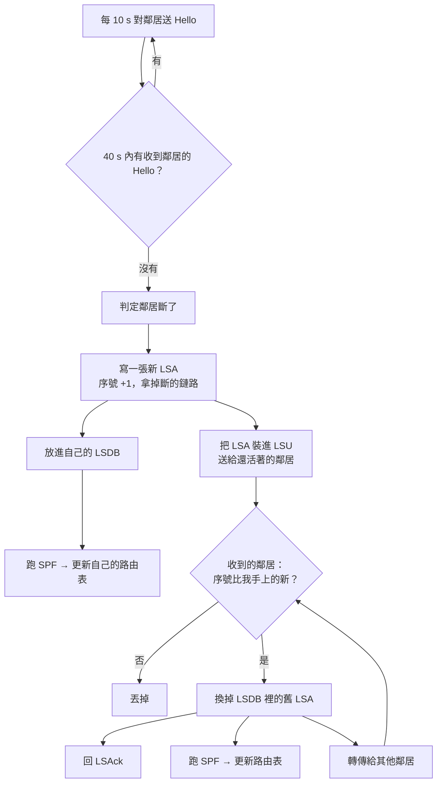
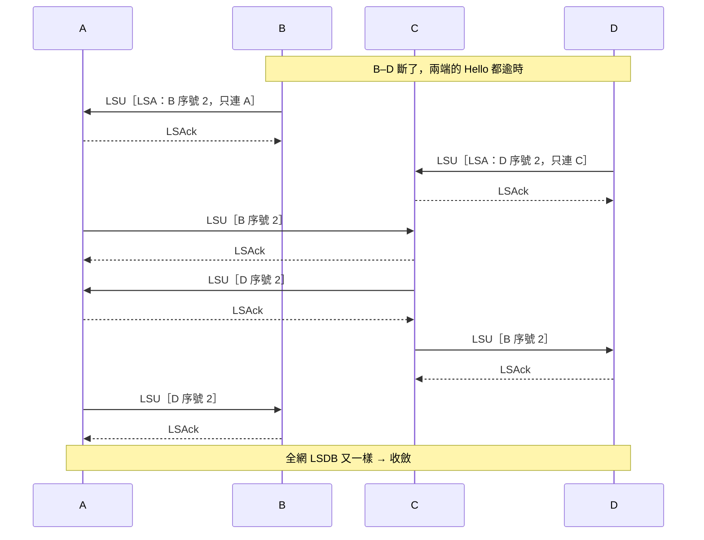
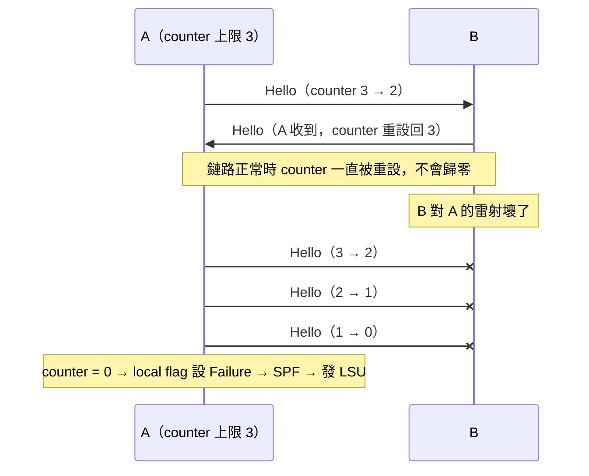
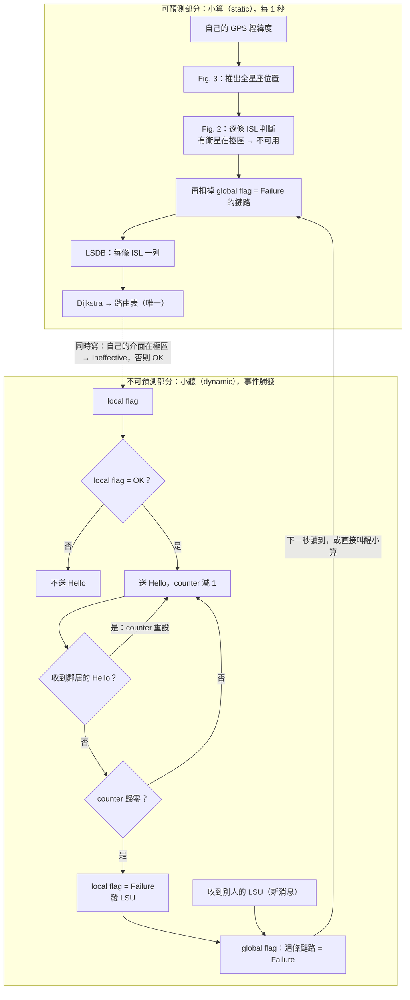
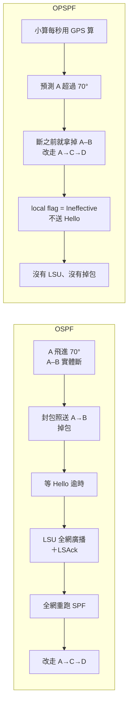
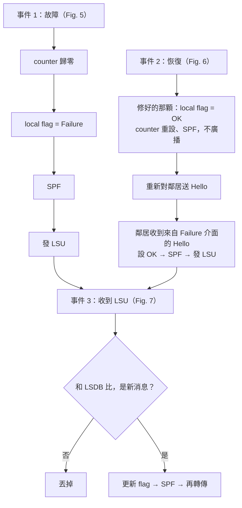

## Citation
T. Pan, T. Huang, X. Li, Y. Chen, W. Xue, Y. Liu, "OPSPF: Orbit Prediction Shortest Path First Routing for Resilient LEO Satellite Networks," IEEE, 2019.

## 一句話摘要
**OPSPF（Pan et al., IEEE ICC 2019）** 要解決的是 OSPF 用在極軌 LEO 星座上的問題：衛星進入極區（緯度 >70°）時，跨軌 ISL 會規律性地斷開。OSPF 不知道這是「可預期的」，只能等 Hello 逾時再全網泛洪 LSU，造成收斂延遲和封包遺失。另一種做法是快照法（snapshot），它要存大量拓撲、很吃記憶體，也處理不了突發故障。OPSPF 把路由拆成兩個模組。**靜態模組**每 1 秒由各衛星用自己的 GPS 和軌道參數推算所有衛星位置，先把極區內會斷的跨軌鏈路移除，再建 LSDB、跑 Dijkstra，得到路由表。**動態模組**保留 OSPF 的 Hello/LSU，但只在 local flag 為 OK 的介面上運作，專門偵測非預期的故障。兩個模組之間用 local flag（OK/Failure/Ineffective）和 global flag（OK/Failure）溝通，最後共用同一張路由表。作者在 Exata 5.1 + STK 上用 LEO-48（6 軌 × 8 星）實作驗證。結果是：可預期的極區鏈路變化完全不需要控制封包、收斂時間為 0（OSPF 約 543 ms、235 個封包）。對突發故障，控制封包少約 57%、收斂快約 82%（約 100 ms、101 個封包）。不過這篇也有限制：極區內的故障偵測不到，只對近極軌（Walker Star 類）星座有效，省下的封包有一部分來自拿掉 LSAck，只測了一種星座，程式碼也沒有公開。（最後一句的限制是我自己的評語，不是作者寫的。）

**English:** OPSPF (Pan et al., ICC 2019) targets a weakness of OSPF in polar-orbit LEO constellations. Inter-plane ISLs break predictably when satellites enter the polar region (>70° latitude), but OSPF treats these breaks as failures, waiting for Hello timeouts and then flooding LSUs network-wide, which causes slow convergence and packet loss. Snapshot-based methods avoid this but need a lot of memory and cannot handle sudden failures. OPSPF splits routing into two modules. A static module runs every 1 s: each satellite predicts all satellite positions from its own GPS and orbital parameters, removes the polar inter-plane links, builds the LSDB and runs Dijkstra. A dynamic module keeps OSPF Hello/LSU only on interfaces whose local flag is OK, so it catches only unexpected failures. Local and global flags link the two modules, which share a single routing table. In an Exata/STK simulation of a 48-satellite (6×8) constellation, predictable topology changes needed zero control packets and zero convergence time (OSPF: about 543 ms and 235 packets). For unexpected failures, OPSPF used about 57% fewer control packets and converged about 82% faster. Limitations: failures inside the polar region go undetected, the benefit is limited to near-polar constellations, part of the saving comes from dropping LSAck, and only one constellation was tested.

## 0. 背景知識
> 讀這篇前需要的五件事：ISL 是什麼、OSPF 怎麼運作、星座長什麼樣、為什麼極區會斷線、實驗用的工具。

### 先看這裡：最常搞混的四件事（速查）

| 問題               | 一句話答案                                                                              | 細節                |
| ---------------- | ---------------------------------------------------------------------------------- | ----------------- |
| Polar orbit 長怎樣  | 軌道像地球儀上的經線，全部在南北極交會（Walker Star）；靠近極點時跨軌 ISL 會斷                                    | §0 Walker、極區；§0.5 |
| LSA／LSU／LSDB／路由表 | 明信片／信封／相簿（全網地圖）／指路牌                                                                | §0 OSPF           |
| OSPF vs OPSPF    | OSPF：斷了才聽到，再全網廣播；OPSPF：該斷的自己用 GPS 算，只有意外才用 OSPF 那套                                 | §0 OSPF、§3.3、§3.7 |
| Fig. 4           | 小算（static）寫路由表和 local flag；小聽（dynamic）讀 local flag、寫 global flag；兩個 flag 是它們傳紙條的白板 | §3.3              |
| 整體流程圖            | OSPF、OPSPF（可預測＋不可預測）、LSA／LSU／LSAck、keepalive 的流程圖                                  | §2.5              |

### ISL（Inter-Satellite Link，衛星間鏈路）
- 衛星之間直接通訊的鏈路，現代多用雷射。沒有 ISL 時資料只能「上去再下來」（bent-pipe），海洋或偏遠地區難以覆蓋。
- 一般每顆衛星有 4 條 ISL，連成棋盤狀（+Grid）。本文的衛星有 **4+1 個介面**：4 條 ISL，加 1 個對地介面。

| | Intra-plane ISL（同軌） | Inter-plane ISL（跨軌） |
|---|---|---|
| 連誰 | 同一條軌道上前、後兩顆 | 左、右相鄰軌道上的那顆 |
| 距離 | 固定（本文延遲 16.6–16.8 ms） | 隨緯度變：赤道最遠、越靠近極區越近（5.6–11.7 ms） |
| 穩定嗎 | 永遠連著 | 進極區會斷，是拓樸變化的主因 |

- 分工提醒：「連哪顆衛星」是**拓樸設計**（DoTD、LAMP）；「封包走哪條鏈路」是**路由**（OPSPF、StableRoute、StepClimb、SHORT）。

### OSPF（Open Shortest Path First）
地面網路最常用的 link-state 路由協定。一句話：**靠打招呼發現斷線，再廣播給大家，每個人各自重算最短路。**

**比喻：每個路口的指路員都拿著同一張城市地圖**。指路員是路由器（衛星），路過的人是封包。OSPF 就是讓大家地圖保持一致、保持最新的規則：
1. **Hello（打招呼）**：定時對隔壁喊「我還在！」。好幾次沒回應，就判定這條路斷了。
2. **LSU（廣播消息）**：發現路斷的人把「某某路斷了」傳給所有鄰居，鄰居再往下傳，直到全網都知道（flooding）。
3. **LSAck（回條）**：收到 LSU 要回一張回條，沒收到回條的會重傳，確保消息不會掉。
4. **LSDB（更新地圖）**：大家在自己的地圖上把那條路劃掉，地圖保持一致。
5. **SPF（重新找路）**：每個人用 Dijkstra 在新地圖上重算最短路，得到路由表。

**四個名詞：LSA、LSU、LSDB、路由表**

| 名詞 | 比喻 | 是什麼 | 每顆衛星的都一樣嗎 |
|---|---|---|---|
| LSA（Link State Advertisement） | 明信片 | 一台路由器的自我介紹：「我是誰、連著誰、成本多少」，附序號 | （每張只描述一台） |
| LSU（Link State Update） | 信封 | 真正在網路上傳的封包，裡面裝一張或多張 LSA | — |
| LSDB（Link State Database） | 相簿＝全網地圖 | 收集每台路由器**最新**的那張 LSA，拼起來就是地圖 | 一樣 |
| 路由表 | 路口的指路牌 | 「要去 X，交給哪個鄰居」，由 LSDB 跑 Dijkstra 算出 | 各自不同 |

以下用 A–B–C–D 圖示意。成本 3、5、6 是自己編的，論文沒定義成本（見 §3.3）。

```
A ——3—— B
|       |
5       5
|       |
C ——6—— D
```

**① LSA**：A 的明信片 =「發出者 A，序號 1，鏈路：A–B 3、A–C 5」。

**② LSU**（照 OSPFv2 簡化；OPSPF 論文沒寫自己的格式）：

```
OSPF 標頭：類型 4 = LSU（1 = Hello、5 = LSAck），寄件人 B
內容：LSA 數量 1
  └ LSA：發出者 B，序號 2，鏈路：B–A 3    ← B–D 不見了 = 斷了
```

**③ LSDB**：一台路由器一格，只放最新那張 LSA。
- 新 LSA 來了比序號：比較大就換掉並轉傳；一樣或比較小就丟掉（就是 Fig. 7 的 *Coherence?*）。
- 拼地圖時，一條鏈路要**兩端的 LSA 都有寫**才算數。所以只要任一端的新 LSA 先到，就能把斷掉的鏈路拿掉。

**④ 路由表**（A 的）：

| 目的地 | 下一跳 | 總成本 |
|---|---|---|
| B | B | 3 |
| C | C | 5 |
| D | B | 8（A→B→D） |

- **一次故障怎麼傳**：B–D 壞 → B、D 各寫一張新 LSA → 裝進 LSU 送給鄰居 → 鄰居比序號、換掉舊的、重跑 Dijkstra、再轉傳 → 全網的相簿又一樣（收斂）。A 的表裡 D 改交給 C（成本 11）。
- 這個 4 顆的例子共傳 6 個 LSU。標準 OSPF 每個還要回 LSAck，共 12 個；OPSPF 不回，只有 6 個。
- OPSPF 的 LSDB 不是靠收集 LSA 拼出來的，見 §3.3。

**直接用在衛星上的問題**：衛星每次飛進極區，某些 ISL **一定會斷**，而且每圈都重複。OSPF 每次都要等 Hello 逾時才發現（這段時間封包會掉）、再全網廣播（佔頻寬）。本文量到每次約 **543 ms、235 個控制封包**。

**OPSPF 的改法**：極區斷線是**可預測的**（就像知道某座橋每晚 10 點會升起），每顆衛星看自己的 GPS 就知道哪條鏈路該劃掉，不必等別人喊；只有**真正的意外**（橋突然壞掉）才用 OSPF 的 Hello 和廣播。

### Walker Star 和 Walker Delta 星座
- **傾角**：軌道平面和赤道的夾角。0° 沿赤道繞，90° 正好經過南北極。傾角接近 90° 的叫 **polar orbit（極軌道）**。
- **Walker 星座**：「平均擺放」衛星的標準設計，所有軌道高度、傾角相同，每條軌道上的衛星等間距。依軌道怎麼排分兩種：

| | Walker Star | Walker Delta |
|---|---|---|
| 傾角 | 接近 90°（如 Iridium 86.4°、OneWeb 87.9°） | 較小（如 Starlink 第一層 53°） |
| 軌道面分布 | 只鋪 **180°** 經度 | 鋪滿 **360°** 經度 |
| 比喻 | 地球儀上的經線，全部在南北極交會 | 毛線球上斜斜纏繞的毛線 |
| 軌道在哪交會 | **極區** | **中緯度** |
| 會進 ±70° 極區嗎 | 會，每顆衛星每圈**兩次**（北、南各一次） | **不會**（最北只到 53°） |
| Seam（縫） | 有：第一和最後一面並排卻反向飛，通常不連 ISL | 沒有：每一面都能和隔壁連 |
| 對 OPSPF 的意義 | 跨軌 ISL 規律地斷、再接回，正是 OPSPF 要預測的 | 極區斷線規則根本不會觸發 |

- **OPSPF 屬於哪種**：論文只寫「polar orbits」，沒用 Walker 這個詞；但相鄰軌道經度差 $180/M$（只鋪 180°），Fig. 1 也標出了 seam，所以是 Walker Star（inference）。
- 所以 OPSPF 最大的賣點（規律變化 0 封包）主要適用 Walker Star 型星座。

### 為什麼極區（緯度 > 70°）的 inter-plane ISL 會斷
**原文只有一句話**（§II-A，Fig. 1 的說明）：
> "If a satellite moves into the polar region, its inter-plane ISL towards a higher-latitude satellite will be disconnected due to the antenna tracking limitation. While the intra-plane ISLs always keep connected."

- 作者給的理由只有「**天線追蹤能力的限制**」，沒有再解釋，也沒說明為什麼邊界選 ±70°。
- 斷的只有「**朝向更高緯度那顆衛星**」的跨軌 ISL，同軌 ISL 一直都在。

**「天線追蹤限制」是什麼意思**（一般背景知識，不是論文寫的）：
- ISL 天線要一直**對準**鄰居，靠會轉的雲台去追；雲台的轉速和角度範圍都有上限。
- **同軌鄰居**一起飛，相對位置幾乎不變，天線幾乎不用轉。
- **跨軌鄰居**在赤道附近穩穩待在左邊或右邊；越靠近極點，兩條軌道越擠、越快交叉，過了極點鄰居會從**右邊**跑到**左邊**，天線要在很短時間內甩轉將近 180°。
- **比喻**：兩台車在兩條會交叉的車道上並排開，你從車窗拿手電筒照著隔壁車。平常手穩穩舉著就好；到了交叉口，隔壁車忽然從右邊穿到左邊，手根本轉不過來。

所以設計上乾脆在進極區時**先把跨軌 ISL 關掉**，出了極區再重新連線。這件事每圈都發生、時間可預測，OPSPF 才能用軌道預測處理，不必等 Hello 逾時。

### 實驗工具：STK 和 Exata

| | STK 9.2.1 | Exata 5.1 |
|---|---|---|
| 是什麼 | 衛星軌道模擬軟體（AGI，現屬 Ansys） | 網路**仿真器**（emulator） |
| 負責 | 算出每顆衛星在每個時間點的位置（軌跡） | 模擬封包怎麼在鏈路上傳、協定怎麼反應 |
| 比喻 | 天文台：只管衛星在哪 | 交通模擬器：只管車（封包）怎麼跑 |
| 取得 | 商用，要授權 | 商用，要授權 |

- **emulation（仿真）vs simulation（模擬）**：simulation 用簡化模型「假裝」協定在跑；emulation 是**真的把協定程式碼放進去跑**，只是鏈路和延遲換成虛擬的。比喻：simulation 像用公式算車流，emulation 像在駕訓班場地讓真的車開。
- **Exata 的一般用法**：在圖形介面或設定檔裡放節點、設定協定、流量和故障時間；節點位置可讀外部軌跡檔（本文讀 STK 的輸出）；新協定要自己用 C／C++ 寫好編譯進去；跑完輸出統計和 log。本文怎麼用見 §4。
- **免費替代品**：網路部分有 ns-3（LEO 專用的 Hypatia 建在它上面）、OMNeT++、Mininet（StableRoute 用這個）；軌道部分可直接用 Walker 公式或 Python 的 Skyfield／SGP4。
- **不是所有路由論文都需要這種工具**：要量控制封包、收斂時間這類**協定行為**，才需要封包層級的仿真；只看路徑長度、hop 數的話，Python 建圖就夠（例如 StepClimb）。

## 0.5 拓樸基礎（Base Topology）
OPSPF 的拓樸是**標準的 polar 星座加上網格狀（+Grid）連線**，而且拓樸是**給定的**：論文不設計「誰連誰」，只在這張固定的網上做路由。

**1. 星座形狀**（§II-A、§IV-A）
- $M$ 條 polar orbit，每條 $N$ 顆衛星，等間距排列。
- 實驗用 **LEO-48 = 6 條軌道 × 8 顆**，繞地球一圈約 6900 s，軌跡由 STK 9.2.1 產生。
- 軌道有方向：有的往北飛、有的往南飛（Fig. 1 的 orbit 1 往北、orbit 6 往南）。
- 同軌每顆相隔 45°（360°/8），相鄰軌道再錯開 22.5°，排起來像磚牆一樣交錯（Table I）。

**2. 每顆衛星怎麼連（+Grid）**
- 每顆衛星有 4+1 個接口：
  - **2 條 intra-plane ISL**：同一條軌道上的前一顆和後一顆，永遠連著。
  - **2 條 inter-plane ISL**：左右相鄰軌道上的那顆。
  - **1 個對地**接口。
- 畫出來就像棋盤格（直線＝intra-plane，橫線＝inter-plane）：

```
 orbit1  orbit2  orbit3
   ●──────●──────●
   │      │      │
   ●──────●──────●
   │      │      │
   ●──────●──────●
```

**3. 唯一的「動態」規則**
- 衛星進入極區（|緯度| > 70°）時，**朝更高緯度那顆衛星的 inter-plane ISL 斷掉**，出了極區再接回來。
- 除此之外拓樸不變，所以整張網只是「棋盤格裡的橫線，按照緯度週期性地消失、出現」。這正是 OPSPF 能用 GPS 預測拓樸的前提。

**4. 規模感**
- 論文說實驗中平均約有 **75 條 ISL 連著**，用來算 Hello 數量：75 × 2 × 2 = 300（每 2 s）。
- 我的推算（inference，非論文內容）：48 條 intra，加上 5 對相鄰軌道 × 8 = 40 條 inter，共 88 條；扣掉極區斷掉的，大約剩 75 條，數字對得上。這也暗示 **seam 兩側（orbit 1 和 6 之間）沒有連線**，但論文沒有明講。

**5. 和其他筆記的關係**
- 這種「棋盤格＋極區斷橫線」就是 StableRoute 用的 Walker Star / +Grid 模型。
- DoTD、LAMP 則是去**改這張棋盤怎麼連**；OPSPF 和 StableRoute 都假設棋盤已經給定，只管封包怎麼走。

## 1. Problem & Motivation
- LEO topology 週期性變化：衛星進入 polar region 後，因 antenna tracking 限制，inter-plane ISL 斷開。
- 直接用 OSPF：每次變化都經 Hello timeout 偵測再 flood 全網，造成無止境的 route convergence，耗用 ISL 頻寬。
- Snapshot-based 方法 [4–7]：衛星要在有限 memory 存大量 routing table snapshots，或頻繁與 ground station 互動上傳 snapshot。

### 研究目標
- **終極目標**：讓 LEO 衛星網路在拓樸一直變的情況下，路由還能**又省又穩**：可預測的變化不花任何代價，意外故障也還能處理。換句話說，就是「把地面最成熟的 OSPF，改造成適合衛星的版本」。
- 對應標題的三個詞：
  - **Orbit Prediction**：每顆衛星只靠自己的 GPS 算出全網拓樸，不用存 snapshot（§II 標題就叫 *Memory-Efficient* Static Routing）。
  - **Shortest Path First**：規律變化做到 0 個控制封包、0 收斂時間，不用 flood。
  - **Resilient**：保留 OSPF 的 Hello/LSU，但只在需要時啟動（on-demand），遇到意外也不癱瘓。
- **沒有 problem formulation**：全文沒有目標函數或限制式，是「系統設計＋實作＋實驗」型論文。最接近問題定義的是 §III-A Design Space Analysis 用文字提出的兩個設計問題：
  1. Static 是**計時器同步觸發**，OSPF 是 **Hello timeout 非同步觸發**，合在一起時路由計算該怎麼觸發？
  2. 兩邊各自會產生路由表，封包要聽誰的？衝突時怎麼辦（coherence issue）？
- **它不追求的事**：少換路（這是 StableRoute 要補的）、最低延遲、負載平衡、理論最佳。

### 為什麼用「封包數」來衡量
- **資料封包**是使用者真正要傳的東西；**控制封包**（Hello、LSU、LSAck）是路由器之間「討論地圖」用的，不載使用者資料，純粹是成本。ISL 頻寬和衛星電力都有限，控制封包越多，留給資料的越少。
- 論文量兩件事，各對應一個目標：

| 量什麼 | 對應目標 | 為什麼重要 |
|---|---|---|
| 控制封包數（OSPF 235 vs OPSPF 0／101） | **省** | 控制封包越少，留給使用者資料的頻寬越多 |
| 收斂時間（OSPF 543 ms vs OPSPF 0／100 ms） | **穩** | 收斂完成前路由表是錯的，資料封包會被送進斷掉的鏈路而遺失 |

- 例：實驗資料流是 100 pps，收斂 543 ms 期間大約有 54 個資料封包被送往斷掉的鏈路（我的估算）；OPSPF 處理極區斷線是 0 ms，所以一個都不會掉。

## 2. Key Idea
- **Regular change**：每顆衛星只靠自己的 GPS 位置就能預測所有衛星位置，推出瞬時 topology，本地跑 SPF（預設每 1s）。不需 flooding、不存 snapshot。
- **Irregular change**（link failure/recovery）：把 OSPF Hello/LSU 以 on-demand 方式嵌入，只在衛星位於 polar region 外時偵測。
- 只有一張 routing table，由 static module 產生；dynamic module 只回饋 interface flag。
- 實驗裡兩種變化的來源也不同：regular change 是衛星照軌跡飛進 ±70° **自然發生**的；irregular change 是實驗者在 Exata 裡**事先排好的故障**（fault injection，見 §4）。

### OSPF vs Snapshot-based vs OPSPF
重新計算的是 **路由**（routing table），不是實體鏈路；ISL 的連上和斷開由軌道幾何決定。

| | Traditional OSPF | Snapshot-based | OPSPF |
|---|---|---|---|
| 核心概念 | 鏈路變了**之後**才重算路由 | **事先**把所有路由算好，時間到就切換 | 每顆衛星**即時**在本地預測拓樸並重算 |
| 流程 | 鏈路斷 → Hello timeout 偵測 → flood LSU → 全網跑 Dijkstra | 地面把一個週期切成多個時間片（snapshot），預算每片的 routing table 並上傳 → 衛星按時間表切換 | 由 GPS 位置推算所有衛星位置 → 推出當下拓樸 → 每 1s 跑 SPF |
| 是否需要軌道資訊 | 不需要 | 需要（在地面離線計算） | 需要（在衛星上即時計算） |
| 規律變化（極區斷線） | 每次都要 flood 和收斂，耗頻寬、會掉封包 | 不需偵測，也沒有收斂延遲 | 不需偵測，也沒有收斂延遲 |
| 突發故障 | 可以處理 | 無法處理（snapshot 裡沒有） | 退回使用 OSPF 的 Hello/LSU 處理 |
| 主要成本 | Flooding overhead、收斂時間（本文為 543 ms） | 衛星 memory 要存大量表格，且需反覆從地面上傳 | 每秒一次的 Dijkstra 運算 |

一句話總結：OSPF 是「鏈路變了**之後**才重算」；snapshot 是「**事先**全部算好，時間到就切換」；OPSPF 則是「可預測的變化用預測**即時**算，不可預測的故障**事後**用 OSPF 補」。

## 2.5 圖解：OSPF 和 OPSPF 怎麼跑（流程圖）
> 這一節只放圖，把散在各節的東西串成一條線。名詞定義見 §0（LSA／LSU／LSDB／路由表），flag 細節見 §3.3，A–B–C–D 的完整故事見 §3.7。圖在 Obsidian 會自動畫出來（Mermaid）。

### 2.5.1 各自用在哪、要解決什麼問題

| | OSPF | OPSPF |
|---|---|---|
| 原本用在哪 | 地面網路：公司、校園、ISP 內部的路由器 | LEO 極軌星座（Walker Star），每顆衛星就是一台路由器 |
| 拓樸怎麼變 | 很少變；變了多半是**意外**（光纖被挖斷、設備壞掉） | 一直在變；大多**可預測**（每圈進出極區兩次），少數是意外故障 |
| 要解決的問題 | 意外發生後，讓全網盡快知道並改路 | 可預測的變化不要再廣播、不要掉包；意外故障仍然要能處理 |
| 怎麼知道拓樸 | 只能「聽」：Hello ＋ LSA | 「算」＋「聽」：GPS 預測，只有意外才用 Hello／LSU |
| 搬到衛星上的問題 | 每次極區斷線都當成意外：等逾時、全網廣播（約 543 ms、235 個控制封包） | — |
| 自己的弱點 | — | 只對會穿過極區的星座有用；極區內的故障偵測不到；沒有 LSAck，LSU 掉了沒人知道 |

### 2.5.2 OSPF：只靠「聽」



- Hello 10 s、Dead 40 s 是 OSPF 的預設值，不是論文的設定。
- **LSDB 先改，路由表是從 LSDB 算出來的。**

**LSA、LSU、LSAck 在網路上怎麼跑**（A–B–C–D 圖，B–D 斷掉）：



- 實線是 LSU（6 個），虛線是 LSAck（6 個）。**OPSPF 沒有虛線那 6 個。**

### 2.5.3 Keepalive：怎麼判斷「鄰居斷了」

OPSPF 用 keepalive counter（Fig. 5）；OSPF 用 Dead timer，概念一樣：「太久沒聽到對方就算斷」。



- 論文的 Hello 間隔是 1 s；counter 上限論文沒寫，3 是假設。
- 只有 local flag = OK 的介面才會送 Hello；Ineffective（極區）完全不送。

### 2.5.4 OPSPF 全貌：上半「算」、下半「聽」



- 上半每秒都跑，**不送任何封包**；下半平常只有 Hello，出事才有 LSU。
- 兩半只透過兩個 flag 溝通：小算寫 local、讀 global；小聽讀 local、寫 global。
- 極區斷線**只經過上半**，所以不廣播；意外故障**從下半開始，經 global flag 回到上半**，最後還是由小算出路由表。

### 2.5.5 可預測部分：同一次極區斷線，兩者怎麼處理



- 每顆衛星都用同一套公式算，所以不必互相通知，全網的 LSDB 自然一致。
- 本文結果：OSPF 約 543 ms、235 個控制封包；OPSPF 0 ms、0 個。

### 2.5.6 不可預測部分：故障、恢復、收到 LSU



- 這部分幾乎就是 OSPF，只差兩點：**只在 local flag = OK 時偵測**，而且**沒有 LSAck**。
- 真實例子是論文 Fig. 8：E 的介面 0 故障 → A 的 Hello 逾時 → A 發 LSU → 一圈圈傳到全部九顆。

## 3. Method
四個部分的分工：static module 處理可預測的變化，dynamic module 處理突發故障，兩者寫入同一張 routing table。

**3.1 Static workflow（每秒跑一次，Fig. 2）**：Geo data（GPS）→ 計算所有衛星位置 → 與 polar boundary（±70°）比對，把進入極區的衛星朝高緯度方向的 inter-plane ISL 標記為斷 → 更新 LSDB → SPF（Dijkstra）→ routing table。這就是「即時計算」的部分。
- **Fig. 2 左半：三個階段**
  1. *Satellite location calculation*：從 GPS 拿到自己的位置 → 推算其他所有衛星位置（灰色框，細節在 Fig. 3）。
  2. *Topology calculation*：判斷每條 ISL 通不通（展開在右半）→ 寫進 LSDB。
  3. *Route calculation*：跑 Dijkstra → 更新路由表。
- **Fig. 2 右半：一條鏈路怎麼判斷**：自己的位置 → 算出鄰居位置 → *In polar region?* 是 → *Disconnected*；否 → *Connected* → 寫進 local link status。左下的 *Link status initialization* 是一開始設定初始狀態，之後只做更新。
- 流程圖只畫「在極區嗎？」，但正文說斷的是**朝更高緯度那顆的 inter-plane ISL**；intra-plane 永遠 Connected。
- **Fig. 2 = static module 本身**，還沒有 flag 的純預測版；Fig. 4 才把 dynamic module 的 Failure flag 接進來。
- 全程**不送任何封包**，全部在衛星自己的機器裡算完，下一秒再重來一次。

**3.2 Orbit prediction（從自己的位置推出所有人的位置）**：$M$ 個 orbit、每 orbit $N$ 顆，等間距排列；local 為 $S(x,y)$；$d=\pm1$ 代表運動方向（北行／南行）。$c_0=360/N$，$c_1$ = 相鄰 orbit 的 latitude 相位差，$c_2=180/M$。
- 換 orbit：$S(i,y).\lambda=(S(i-1,y).\lambda+c_2+180)\bmod 360-180$，$S(i,y).\varphi=S(i-1,y).\varphi+c_1d$。白話：經度加 $180/M$（polar orbit 只需涵蓋 180° 經度），緯度加上相位差。
- 同 orbit：$S(i,j).\lambda=S(i,j-1).\lambda$，$S(i,j).\varphi=S(i,j-1).\varphi+c_0d$。白話：經度不變，緯度加 $360/N$（一圈平均分配）。
- 摺返：$\varphi>90\Rightarrow180-\varphi$；$\varphi<-90\Rightarrow-180-\varphi$。白話：越過極點後往回走。
- 只靠這三條規則，每顆衛星就能自己推出全部 48 顆的位置和拓樸。
- **Fig. 3 pseudocode 的結構**：兩層迴圈，「先換軌道、再沿軌道」。
  - 外層：i 從自己的軌道 x 開始繞一圈；換到新軌道時先算同編號 y 那顆（經度 $+c_2$、緯度 $+c_1 d$）。
  - 內層：j 從 y 開始沿同一條軌道繞一圈（經度不變、緯度 $+c_0 d$）。
  - 每次都做摺返；`flag` 讓第一次碰到自己時跳過，第二次繞回自己時 `break`，代表全部算完。
- **玩具例子**（M = 3、N = 4 → $c_0$ = 90°、$c_2$ = 60°；假設 $c_1$ = 45°、d = +1；自己在經度 0°、緯度 10°）：同軌道下一顆緯度 10 + 90 = 100 → 摺返成 80°；下一條軌道同編號那顆經度 60°、緯度 55°。
- **我驗算發現的問題**（論文沒提）：只記緯度、用同一個 d 一直加，**過了極點後方向沒有反轉**。例子裡同軌道第三顆應在 10 + 180 = 190° 的位置（緯度 −10°），照 pseudocode 卻是 80 + 90 = 170 → 摺返成 +10°，南北顛倒。正確做法要追蹤繞過的角度，或摺返時把 d 反號、經度加 180°。可能只是 pseudocode 的簡化寫法，實際程式未必有這問題。

**3.3 Hybrid architecture（Fig. 4）**
Fig. 4 有六個框，分上下兩排：上排是 static（小算），下排是 dynamic（小聽），兩個 flag 是它們之間傳紙條的白板。

**比喻：一間指揮站裡的兩個人**
- **小算（static module）**：拿著 GPS 手錶，每秒推算位置、畫地圖、跑 Dijkstra，**唯一能寫路由表**。
- **小聽（dynamic module）**：負責 OSPF 那套，打招呼（Hello）、收發廣播（LSU），專門抓意外故障。**不直接改路由表**，只寫白板（flag）。

**六個框各是什麼**

| 框 | 是什麼 | 誰寫 | 誰讀 | 放大圖 |
|---|---|---|---|---|
| Satellite Geo data | **只有自己**的經緯度（GPS），不是全網資料 | GPS | 小算 | — |
| Static route calculation（小算） | 推全網位置 → 判斷每條 ISL 通不通 → Dijkstra | — | — | **Fig. 2**（位置推算在 Fig. 3） |
| LSDB & routing table | 全網地圖＋自己的路由表，只有一份 | 小算 | 封包轉送 | — |
| Local interface flag | 自己每個介面的狀態 | 小算（極區）；小聽（故障／恢復） | 小聽 | — |
| Dynamic route detection（小聽） | Hello 偵測、收發 LSU | — | — | **Fig. 5、6、7** |
| Global interface flag | 全網哪些鏈路意外壞了 | 小聽（依 LSU） | 小算 | — |

- 原文：小算「also updates the local interface flag for each network interface」；小聽「will update the local interface flag into the global interface flag」。
- Fig. 2 畫的是還沒接 flag 的版本，所以放大圖裡看不到 global flag 的輸入和 local flag 的輸出。

**Fig. 4 配線圖**

```
 GPS（自己的經緯度）─┐
                     ▼
 global flag ──▶ [小算 static] ──▶ LSDB & 路由表（唯一）
   ▲               │
   │               ▼ 寫 Ineffective / OK
   │           local flag
   │               │ 只有 OK 才送 Hello
   │               ▼
   └────────── [小聽 dynamic] ◀──▶ 鄰居的 Hello / LSU
```

- 一圈的順序：GPS ＋ global flag → 小算 → 路由表 ＋ local flag → 小聽 → global flag → 回到小算。
- **兩個時鐘**：小算是「同步」的，每 1 秒跑一次；小聽是「非同步」的，事件來了就處理。小聽處理完可以**直接叫小算立刻重算**，不用等下一秒（只寫在正文，圖上沒畫）。
- 這就回答了 §III-A 的兩個設計問題：觸發方式是「定時＋必要時被叫醒」；路由表只有一張，由小算寫，所以不會衝突。
- 小算知道鏈路斷了只有兩個管道：**GPS 告訴它「該斷的」，global flag 告訴它「意外斷的」**。極區斷線每顆衛星都自己算得出來，所以不用任何人通知。

**兩個 flag 對照**

| | Local flag | Global flag |
|---|---|---|
| 管誰 | 自己的每個介面（每介面一格，最多 4 個 ISL 介面） | 全網每條鏈路（推測：每條一格） |
| 狀態 | OK／Failure／**Ineffective** | OK／Failure |
| 意思 | Ineffective = 在極區、本來就該斷；只有 OK 才送 Hello | Failure = 預測說通、但其實壞了 |
| 每顆衛星內容一樣嗎 | 不一樣 | 收斂後一樣 |

- 例（Fig. 8 故障後；介面編號除了 A(2) 連 E 之外是假設）：
  - A 的 local：A(0) 上 OK、A(1) 下 OK、A(2) 連 E **Failure**、A(3) OK。A 若在極區，跨軌的 A(2)、A(3) 會是 Ineffective。
  - A 的 global：A–E Failure，其他全 OK。
  - 遠方的 C：local 全 OK（C 自己沒壞）；global 和 A 一樣（從 LSU 聽來）。
- 極區斷線不會進 global flag（global 沒有 Ineffective），因為每顆衛星都能自己算出來。

**OPSPF 的 LSDB 長什麼樣**（論文只說把每條 ISL「label the connectivity … which will further update the LSDB」，格式是推測）
- 一條 ISL 一列，LEO-48 共 88 列（§0.5 的推算）。每秒由小算重算、覆蓋舊的。
- 一條 ISL 不能用 = 預測斷（極區）**或** global flag = Failure。實作上大概只存合併後的結果。
- **成本論文沒定義**。推測每條都一樣（等於數跳數）：Fig. 16 說「同樣跳數，延遲也可能不同」；OSPF 預設成本由頻寬決定，而 ISL 規格都一樣。後果是 OPSPF 找的是最少跳數，不一定是最低延遲（StepClimb 則用實際距離）。

| ISL | 成本 | 能用？ | 原因 |
|---|---|---|---|
| S11–S12 | 1 | ✅ | 同軌永遠連著 |
| S14–S24 | 1 | ❌ | S14 在極區（預測） |
| S35–S45 | 1 | ❌ | global flag = Failure |

（後兩列是編的例子。）

**和 OSPF 比**（類比，論文沒這樣比）

| | OSPF | OPSPF |
|---|---|---|
| 自己的介面 | 鄰居狀態機（Down … Full 共 7 種） | local flag 3 種，多了 Ineffective |
| 全網的鏈路 | LSDB 裡每台的 LSA，記全部鏈路 | global flag，只記意外壞掉的 |
| 地圖從哪來 | 全靠別人寄 LSA 來拼 | 自己用 GPS 預測，global flag 只負責扣掉壞的 |
| 誰算路由 | 收到 LSU 就自己跑 SPF | 永遠是小算；LSU 只負責寫 global flag |

- 比喻：OSPF 是大家寄明信片來拼一整張地圖；OPSPF 是手上已經有官方地圖，只在上面貼「此路施工中」的便利貼。

**3.4 Asynchronous events（類似 OSPF 的部分，處理突發故障）**
1. Failure：每送一個 Hello，Keepalive Counter 減 1，收到 Hello 就 reset；歸 0 → 設 Failure → SPF → flood LSU。
2. Recovery：本地只改 flag、reset、SPF，不主動回報；neighbor 收到來自 Failure/Ineffective interface 的 Hello 後設 OK → SPF → flood。
3. LSU：與 LSDB 一致就丟棄（避免無限 flooding），否則更新 → SPF → 再 flood。
- 最壞收斂時間 $T_c=T_d+T_p+T_s$（Keepalive 上限＋最長傳播時間＋SPF 時間），正好就是一條鏈：小聽倒數到 0（事件 1）→ LSU 傳到最遠的衛星（事件 3）→ 被叫醒的小算跑一次 Dijkstra。

**三個事件動到哪塊白板**

| 事件 | 小聽做什麼 | 動到的白板 | 接著 | 廣播 |
|---|---|---|---|---|
| 1. 故障（Fig. 5） | counter 歸零 → 判定鄰居壞了 | **local**：OK → Failure | 叫小算重算 | 有 |
| 2. 恢復（Fig. 6） | 收到從 Failure／Ineffective 接口來的 Hello | **local**：→ OK | 叫小算重算 | 有（由鄰居發） |
| 3. 收到 LSU（Fig. 7） | 比對 LSDB，是新消息 | **global**：更新 | 叫小算重算 | 有（再轉傳） |

**Fig. 5：故障**（左右兩半是同一條鏈路的兩端）
- 送 Hello 的一端：只對可達（OK）的接口送 → *Counter > 0?* 是 → 減 1 → 等一個 Hello 週期 → 再送；否（歸零）→ 鄰居設 Failure → SPF → flood LSU。
- 收 Hello 的一端：收到就把 counter 重設回最大值。所以只要對方活著，counter 永遠不會歸零。
- 注意：圖中的 Ts 是「Hello 間隔」，和 $T_c$ 公式裡的 $T_s$（SPF 執行時間）**同名不同意思**。

**Fig. 6：恢復**（紅色斜虛線分開兩個角色）
- **問題**：壞掉後兩端都不再對這個接口送 Hello，修好後如果沒人先開口，兩邊會一直以為對方還壞著。
- **接口修好的那顆**：*Recovered?* 是 → local flag 改回 OK → counter 重設 → SPF。**不廣播**，但因為 flag 回到 OK，Fig. 5 會重新對鄰居送 Hello，等於「先開口」。（怎麼判斷 Recovered 論文沒說，推測是硬體層看到接口重新 up。）
- **鄰居**：收到從 Failure（或 Ineffective）接口來的 Hello → 設 OK → SPF → **由鄰居 flood LSU**。
- **為什麼由鄰居宣布**：修好的那端只知道自己這頭好了；鄰居收到 Hello 才證明訊號真的傳得過去。也避免兩端各廣播一次。
- 比喻：冷戰的兩個人，先氣消的人主動傳訊息但不張揚；收到訊息的人確定對方回來了，才在群組宣布「我們和好了」。
- 細節：按字面，衛星**離開極區**時（Ineffective → 重新送 Hello）也會走這條路、觸發一次廣播，論文沒特別討論。

**Fig. 7：收到 LSU**
- 收到 LSU → 和自己的 LSDB 比對 → *Coherence?*
  - 一致（聽過了）→ **丟掉**，回去聽。
  - 不一致（新消息）→ 更新 flag → SPF → **再轉傳**。
- 「一致就丟掉」是防止無限循環的關鍵：每顆衛星對同一個消息只轉傳一次，像傳八卦，大家都知道後就自然停了。
- **沒有 LSAck**：OSPF 每收到 LSU 都回 LSAck、沒收到就重傳（像掛號信）；OPSPF 只送不確認（像平信）。LSU 在路上掉了，那顆衛星就不會知道，會繼續把封包送進壞掉的鏈路。

## 3.5 範例：三種方法如何處理同一事件
> 以本文的 LEO-48（6 個 polar orbit × 8 顆，邊界 ±70°）為背景，時間細節為說明用的假設。

封包從台北送到紐約，路徑經過 inter-plane ISL **A–B**。

**事件 1（規律變化）**：t = 100 s 時，A 進入 70°N 以上，A–B 必須斷開。
- **OSPF**：事先不知道。A–B 斷了之後，要等幾個 Hello 週期沒回應才判定斷線，再 flood LSU 給全部 48 顆衛星，大家重跑 Dijkstra。在這之前封包仍被送往 A–B 而遺失（本文：約 543 ms、235 個控制封包）。
- **Snapshot**：地面早已算好「100–130 s 用第 4 張表」，表 4 裡沒有 A–B。t = 100 s 時 A 直接換表，改走 C，不掉封包，但 A 必須存幾十張表。
- **OPSPF**：A 在每秒一次的更新中，由 GPS 算出「我已經超過 70°，A–B 不能用」，自己跑 Dijkstra 改走 C。不掉封包、不 flood（0 個封包），也不存表。

**事件 2（突發故障）**：t = 300 s 時，C–D 的雷射突然故障。
- **OSPF**：和事件 1 一樣，偵測 → flood → 重算。
- **Snapshot**：表上還寫著 C–D 可用，封包持續送往 C–D 而遺失，直到地面重新上傳表格。
- **OPSPF**：預測上 C–D 應該正常，但 Keepalive counter 歸零 → 設 Failure → 重算並 flood LSU（本文：約 100 ms、101 個封包）。

結論：OSPF 每次變化都慢；snapshot 遇到突發故障束手無策；OPSPF 結合兩者的優點。

## 3.6 四顆衛星走一遍 Fig. 2–7

```
 A ——— B      A–B、C–D：inter-plane（會因極區斷）
 |     |      A–C、B–D：intra-plane（永遠連著）
 C ——— D      A 要送到 D，一開始走 A→C→D
```

假設 Keepalive Counter 最大值 = 3，Hello 每 1 秒一次。

| 時間 | 事件 | 經過哪些圖 | 白板變化 | 廣播 | A→D 路由 |
|---|---|---|---|---|---|
| 0 s | 一切正常 | Fig. 2／3 算路；Fig. 5 右半一直 reset counter | 全 OK | 無 | A→C→D |
| 10 s | C–D 雷射突然壞 | Fig. 5 左半：D 的 counter 3→2→1→0 → 設 Failure → flood；Fig. 7：B、A、C 依序收到新消息並轉傳，重複的丟掉；Fig. 4：A 的 global flag 寫 C–D Failure | global C–D = Failure | 有 | A→B→D |
| 20 s | C–D 修好 | Fig. 6：D 自己改 OK 不廣播；C 收到 D 的 Hello → 設 OK → flood；再走 Fig. 7 | global C–D = OK | 有 | 兩條都可 |
| 30 s | A 進極區 | Fig. 2：*In polar region? Y* → A–B Disconnected；Fig. 4：local A–B = Ineffective → Fig. 5 不對 A–B 送 Hello。B、C、D 也各自用 GPS 算出來 | local A–B = Ineffective | **無** | A→C→D |
| 40 s | A 出極區 | Fig. 2：*N* → A–B Connected，flag 回 OK；Fig. 6：B 收到從 Ineffective 接口來的 Hello → 設 OK → flood | local A–B = OK | 有（按字面） | 不變 |

- 若 A 在極區時 A–B 真的壞了（30–40 s），因為不送 Hello，**發現不了**，要等出極區才偵測到，這是作者自己承認的限制。
- 一句話：**可預測的事只走 Fig. 2；意外的事從 Fig. 5 或 Fig. 6 開始、經過 Fig. 7 擴散，最後透過 Fig. 4 的 flag 回到 Fig. 2 重算。**

## 3.7 對著 Fig. 4 看 OSPF 和 OPSPF：兩個故事
> 玩具數字（距離成本、緯度、OSPF 預設 Hello 10 s／Dead 40 s）是說明用；只有「每 1 秒算一次」和「±70°」來自論文。

```
軌道1   軌道2
  A ——3—— B      高緯度，兩條軌道靠得近
  |       |
  5       5
  |       |
  C ——6—— D      低緯度，兩條軌道離得遠
```

A 要送到 D：A→B→D = 8，A→C→D = 11，平常走 A→B→D。

**先記一句：OSPF ＝ Fig. 4 的下排；OPSPF ＝ 下排 ＋ 新加的上排（GPS 預測），中間用兩個 flag 接起來。**
- OSPF 沒有 Geo data、Ineffective 和定時預測的小算，只在收到 LSU 時才跑 SPF（對照表見 §3.3）。

**故事一：A、B 一開始就在極區（72°），之後飛出去**

| 階段 | OPSPF（上排在動） | OSPF（只有下排） |
|---|---|---|
| 72°，在極區 | GPS → 小算標 local A–B = **Ineffective**，算路不用它 → **A→C→D**；小聽不對 A–B 送 Hello；global 全是 OK，**沒有 LSU** | A–B 本來就連不上，沒建鄰居 → 也走 A→C→D（起點兩邊差不多） |
| 飛到 69°，出極區 | GPS 顯示 < 70°、global A–B 也是 OK → 小算放回 A–B → **A→B→D**；小聽恢復 Hello，收到回應 | 收到 Hello → 交換資料庫建鄰居 → LSU 全網廣播 → 大家重跑 SPF → A→B→D；這段期間只是繞遠路，不掉包 |
| （反過來）從 69° 飛進 70° | 小算**斷之前**就改走 A→C→D，不等、不廣播 | 斷了也不知道，封包照送 A→B 而**掉**；等 Dead 40 s → LSU 全網廣播 → 重算；Walker Star 每顆衛星每圈進出兩次，所以全網一直在廣播 |

- **在極區時 A–B 其實壞了？** OPSPF 不送 Hello，所以沒人發現（論文 §III-D：「nothing will happen until E moves out of the polar region」）。出極區時小算看 global 還是 OK，會先把路由改回 A→B→D；等 Hello 逾時 → LSU → global A–B = Failure → 改回 A→C→D。
- （推測）中間等 Hello 逾時的空窗，往 A→B 的封包可能會掉，論文沒討論這段多長。

**故事二：B–D 突然壞掉（不在極區）**

| 步驟 | OSPF | OPSPF（Fig. 4 箭頭） |
|---|---|---|
| 偵測 | Hello 收不到 → 逾時 → 判定故障 | 一樣；local B–D 是 OK 才有在送 Hello（Fig. 5） |
| 廣播 | LSU 全網 flood | 一樣（Fig. 7） |
| 寫白板 | 沒有白板 | 小聽寫 **global B–D = Failure** |
| 誰算路 | 收到 LSU 的衛星**自己直接**跑 SPF | global flag 進小算的 Input → 小算被叫醒或等下一秒 → 扣掉 B–D 跑 Dijkstra → **A→C→D** |
| 修好 | Hello 恢復 → LSU → 重跑 SPF | Fig. 6：鄰居收到 Hello → LSU → global B–D = OK → 小算重算 → A→B→D |

- 偵測和廣播兩邊幾乎一樣。差別是 OPSPF 的 LSU 只負責把消息寫進白板，**真正算路由的永遠是小算**，所以只有一張路由表，不會出現靜態、動態各算一張的 coherence 問題（§III-A）。
- 對照 [3.5](#35-範例三種方法如何處理同一事件) 的數字：OSPF 處理規律變化約 543 ms、235 個控制封包；OPSPF 處理規律變化 0 個封包，處理突發故障約 100 ms、101 個封包。

## 4. Evaluation Setup（§IV-A Methodology）
> 這節就是在交代「實驗場怎麼搭」。工具本身是什麼見 §0「實驗工具」。

### 4.1 實驗流程
1. **算軌跡**：用 STK 9.2.1 產生 LEO-48 繞一整圈（約 6900 s）的衛星位置。至少要跑一整圈，每顆衛星才會都進出極區。
2. **搭網路**：把軌跡餵給 Exata 5.1，依位置決定每個時刻哪條 ISL 存在、延遲多少（極區邊界 ±70°）。
3. **跑協定**：同一個網路、同一份流量和故障劇本，分別裝 OSPF 和 OPSPF 跑，從 log 數控制封包數和收斂時間。**Baseline 只有 OSPF**。

### 4.2 參數（Table I＋正文）

| 參數 | 值 | 白話 |
|---|---|---|
| 軌道數 × 每軌衛星數 | 6 × 8 | 48 顆，Walker Star 型的 polar 星座 |
| 週期 | 6900 s | 約 115 分鐘繞地球一圈 |
| 極區邊界 | ±70° | 論文沒說明為什麼選 70° |
| 相鄰軌道衛星的緯度差 | 22.5° | 同軌每顆相隔 45°（360°/8），相鄰軌道再錯開半格，像磚牆一樣交錯 |
| 同軌 ISL 延遲 | 16.6–16.8 ms | 幾乎固定，同軌鄰居距離不變 |
| 跨軌 ISL 延遲 | 5.6–11.7 ms | 隨緯度變，赤道最遠、靠近極區最近 |
| 流量 | CBR，每條 100 pps × 512 B | 固定速率的假流量（像水龍頭固定滴水），約 0.4 Mbps，很輕，用來測路由不是測塞車；論文沒寫幾對 |
| Hello 間隔 | 1 s | |
| SPF 重算間隔 | 1 s | Fig. 15 有測不同間隔，越長掉越多封包 |
| 實作 | 4897 行 C | 3853 行是基礎架構＋static routing，1044 行是 dynamic routing（動態部分小，推測是大多沿用 OSPF 的 Hello／LSU） |
| 硬體 | i7-6700、16 GB 桌機 | 整個 48 顆衛星網路都在一台桌機上仿真 |

### 4.3 Exata 裡實際怎麼跑（一般運作方式，論文沒寫這麼細）
- **舞台 vs 演員**：Exata 是舞台（時間、節點、鏈路、延遲）；OPSPF 的 C 程式是演員，裝在每顆衛星上決定「該做什麼」。對照組只把演員換成 OSPF，所以比出來的差別就是協定造成的。
- **誰決定什麼**：

| | 誰決定 |
|---|---|
| 資料封包何時送、從誰到誰 | 實驗者事先設定（CBR） |
| 控制封包何時送、送給誰 | 協定自己：Hello、SPF 每 1 s；偵測到故障才 flood LSU |
| 每一跳往哪走 | 當下那顆衛星的路由表（也就是被比較的東西） |
| 突發故障 | 實驗者事先排好（fault injection） |
| 極區斷線 | 不用設定，衛星飛進 ±70° 就由鏈路規則自動斷 |

- **故障注入**：可以設定哪個介面、什麼時候壞、多久恢復。本文 Fig. 11、14 是 200 s 內每 5 s 一次「故障＋恢復」。
- 跑完從 log 數出封包數和時間，就得到 Fig. 9–16。

### 4.4 論文沒交代的（重現時要自己補）
- **程式沒公開**：全文沒有 GitHub 或下載連結；唯一像程式的是 Fig. 3 的 pseudocode（過極點方向沒反轉，見 §3.2）。程式寫在商用 Exata 上，沒授權也跑不起來。
- **參數沒寫**：傾角和高度（只說 polar，高度可由週期反推）、鏈路頻寬和遺失率、流量是哪幾對和何時開始、故障是哪個介面和斷多久、Keepalive 次數、對照組 OSPF 的參數（應是 Exata 預設）。
- 所以就算有 Exata，也很難完全重現論文的數字；要重現只能自己寫簡化版。

### 4.5 為什麼選 Exata（論文沒說，以下是推測）
- 內建公認的 OSPF 實作可以直接當對照組；自己寫的 OSPF 容易被質疑「是不是寫得太爛 OPSPF 才贏」。
- 要量的 Hello 逾時、LSU 逐跳 flood 都需要封包層級模擬。
- 跑的是真的 C 程式，順便證明設計寫得出來、跑得動；也可能只是實驗室現有授權。
- 選 Exata 是為了讓結果**可信**，不是為了**好重現**；難重現是因為劇本沒寫完整、程式沒公開。

**我的觀察**：只有一種星座、一種輕負載、一個 baseline，所以結果只代表「這個設定下比 OSPF 好」。詳見 §7。

## 5. Main Results
**看結果前要懂的名詞**（細節在括號裡的段落，這裡只當索引）

| 名詞 | 一句話 | 詳見 |
|---|---|---|
| Regular vs irregular topology change | 規律變化（進出極區，可預測）vs 突發變化（鏈路故障／恢復）；所有結果都分這兩種 | §2 |
| Route convergence time | 拓樸一變，到全網路由表都更新好要多久 | §1「為什麼用封包數衡量」 |
| Communication overhead | 為了收斂送了多少控制封包 | §1「為什麼用封包數衡量」 |
| Hello / LSU / LSAck | 打招呼確認鄰居 / 廣播哪條鏈路變了 / 收到 LSU 的回條；結果圖數的就是這三種 | §0 OSPF、§3.4 |
| ±70° polar boundary | 規律變化發生的位置 | §0 |

STK、Exata、LEO-48、CBR、4897 行 C 這些只是實驗環境，知道就好（§4）。

- 單次變化封包數：OSPF 235；OPSPF regular 0；irregular 101（約 −57%）。
- 收斂時間：OSPF 543ms；regular 0；irregular 100ms（約 −82%）。
- 每 2s overhead：OPSPF 約 300（全是 Hello，75 ISL×2×2）；OSPF >700。
- 每 5s 一次 failure/recovery（200s 視窗）：OSPF overhead 與收斂時間都較高。
- Route calculation interval 越大，packet loss 非線性上升，故取 1s。
- End-to-end latency 隨 ISL hop 數波動；hop 相同時仍因 ISL 長度不同而有差異。

**怎麼解讀這些數字**
- **規律變化 0 封包、0 收斂時間：真功夫**。OPSPF 根本不送 LSU，自然也不需要 LSAck，是設計本身省下來的。
- **意外故障少 57%：要打折**。論文說計數包含 LSU、LSAck 和 Hello；OSPF 每個 LSU 都有 LSAck，OPSPF 沒有。所以 235 → 101 的差距有一部分只是「少寄回條」，不是更聰明。作者在 §IV 也承認：目前實作比較不可靠，未來可靠版的 overhead 會和 OSPF 差不多。
- 論文沒把 LSAck 的數量拆開。「101 加上 LSAck 大約會接近 235」只是我的粗估。
- 作者的辯護：意外故障很少發生；極區斷線每圈都會發生好幾次，這部分 OPSPF 是 0；而且極區內連 Hello 都不送，平時的控制封包也比較少（每 2 s 約 300 vs 700 多）。

## 6. 這篇算是全新的方法嗎？
不完全是，比較像是把既有元件**重新組合**，創新點在整合方式。
- **不新的部分**：OSPF（Hello、LSU、LSDB）和 Dijkstra 原封不動沿用；用軌道可預測性處理拓樸變化，在 snapshot-based / virtual topology 路由中早已存在；polar 幾何（±70° 斷線）也是標準模型。
- **新的部分**：
  - 每顆衛星在**本地**由 GPS 即時推算拓樸，不用存 snapshot，也不用地面上傳，這是和既有 predictive routing 最大的差別。
  - **混合分工**：規律變化靠預測（零 flooding），突發故障才用 OSPF，並以 flag 機制銜接；極區內甚至不送 Hello。
  - 在 Exata 上完整實作並評估。
- **主要進步在 static 部分**：GPS 預測讓極區斷線 0 封包、0 收斂時間，又不用存表。Dynamic 部分的 Hello／LSU 是 OSPF 原封不動的，價值在於「**把 OSPF 縮小成只處理意外**」（Ineffective 讓極區內不送 Hello、只有一張路由表），而不是發明新的偵測方法。
- 整體偏向「工程設計＋系統整合」型論文，沒有新的最佳化模型或理論證明。它的影響力主要在後續：StableRoute、LAMP 都把 OPSPF 當成 predictive routing 的代表。

## 7. Limitations / 質疑點
**作者自述**
- 沒有 LSU ack/retransmission；作者說可靠版本在意外故障時的 overhead 會接近 OSPF，所以 57% 的封包減少有一部分來自少做 reliability（見 §5）。
- Polar region 內的 failure 要等離開後才偵測到。

**我的質疑（inference）**
- Fig. 3 的 pseudocode 過極點後方向沒反轉，照字面會南北顛倒（見 §3.2）。
- 預測模型是理想化 polar 幾何（等間距、圓軌道、無 Earth rotation 與 J2），也沒特別處理 seam（Fig. 1 有畫出北行和南行的 orbit，但預測和斷線規則沒區分 seam 兩側反向 orbit 之間的 ISL）；能否推廣到 Starlink 這類 inclined、多 shell 星座存疑。
- 只有 48 顆，baseline 只有 OSPF，沒和 snapshot-based 方法比 memory 或 latency。
- 只測 Walker Star。Walker Delta（如 Starlink 53°）的衛星進不了 ±70° 極區，OPSPF 最大的賣點（規律變化 0 封包）在那種星座上幾乎用不到。
- **難重現**：程式沒公開、跑在商用 Exata 上，流量對數、故障位置、Keepalive 次數等都沒寫（見 §4）。
- 每 1s 全網 Dijkstra 在數千顆規模的 CPU 成本與 route flapping 沒評估。
- Link cost 為靜態值，未考慮 congestion 或 load balancing。

## 7.5 和 StableRoute 的關係
- **同一個團隊**（北京郵電大學，Tian Pan 等人）先後的作品，StableRoute 把 OPSPF 列為 ref [5]。
- 一句話分工：**OPSPF 管「什麼時候、怎麼知道要重算」，StableRoute 管「重算之後選哪條路」。**

**接點就在 Fig. 2 的一個方框**
- OPSPF static 流程最後一步 *Shortest path first algorithm* 是普通的 Dijkstra。
- StableRoute 做的事，就是**把這一格換成 SR_L／SR_K／SR_G**；其他部分（GPS 推位置、極區判斷、flag、Hello/LSU）可以照舊。

**用 A、B、C、D 的例子看**（A 要送到 D；A–B、C–D 是 inter-plane）

| 時間 | 事件 | OPSPF（普通 Dijkstra） | 換成 StableRoute |
|---|---|---|---|
| 10 s | C–D 壞了 | A→C→D 斷了，**必須**改走 A→B→D | 一樣必須換（**S1**，避免不了） |
| 20 s | C–D 修好 | A→C→D 和 A→B→D 一樣短，Dijkstra 可能**換回** A→C→D | SR_L：現在這條仍是最短，**不換**（**S2**） |
| 30 s | A 進極區，A–B 斷 | 若 20 s 換回 C 了就不用換，否則要換 | SR_G 事先看整個週期，知道 A–B 等一下會斷，20 s 時就選撐得比較久的路 |

同樣的拓樸變化，OPSPF 可能換路 2–3 次，StableRoute 盡量壓到 1 次。

**StableRoute 對 OPSPF 的批評（StableRoute §II-B）**
- OPSPF 這類「計算型」方法每秒重算，只管算出最短路，**不管路有沒有一直換**；換路會讓封包亂序、傷 TCP。
- 星座越大，每秒重算和把結果寫進資料平面的時間都會快速增加。

**為什麼 StableRoute 不拿 OPSPF 當 baseline**：論文說 OPSPF 和其他協定最後都用 Dijkstra 選路，在「換路次數」上沒有差別，所以直接和 Dijkstra 比就等於和它們比。

| | OPSPF | StableRoute |
|---|---|---|
| 解決的問題 | 拓樸變了，怎麼**不用 flood** 就讓大家知道 | 知道拓樸後，怎麼**少換路** |
| 核心手段 | GPS 預測＋OSPF 補漏 | 下一跳集合＋SR_L/K/G |
| 選路方法 | 普通 Dijkstra | 改良版 Dijkstra |
| 衡量指標 | 控制封包數、收斂時間 | 換路次數、TCP 重傳 |

一句話：OPSPF 讓每顆衛星「即時知道地圖」，StableRoute 讓衛星「看到新地圖時別亂改路線」。兩者可以疊在一起用（inference，兩篇都沒實作合體版）。

## 8. 與其他筆記的關聯
- [[StableRoute_When_Dijkstras_Algorithm_Meets_Topology-Varying_Satellite_Networks]]：同樣在 time-varying topology 上跑 Dijkstra；OPSPF 每 1s 重算不顧路徑穩定性，StableRoute 正處理這個問題。
- [[Stable_Hierarchical_Routing_for_Operational_LEO_Networks]]：OPSPF 是 flat link-state，48 顆無法驗證 operational 規模；SHORT 以 hierarchy 處理可擴展性與穩定性。
- [[Time-_Dependent_Network_Topology_Optimization_for_LEO_Satellite_Constellations]]：OPSPF 把 topology 當給定；DoTD 主動設計 ISL topology，可作為 OPSPF 預測模組的上游。
- [[Shortest_Path_in_LEO_Satellite_Constellation_Networks_An_Explicit_Analytic_Approach]]（StepClimb）：
  - **互補**：OPSPF 每秒跑一次 Dijkstra，StepClimb 用公式直接算出最短距離路徑，可以換掉這一步；OPSPF 的動態模組則補上 StepClimb 不處理故障的缺點。
  - **衝突**：OPSPF 在極區關掉跨軌 ISL；StepClimb 卻偏好在高緯度跨軌，因為那裡跨軌 ISL 最短。StepClimb 的實驗傾角只到 70°，剛好避開這個問題（inference）。
- [[LAMP_Low-Latency_Dynamic_Topology_for_LEO_Satellite_Constellations]]：若 topology 改為動態設計，所有衛星需共享同一個 deterministic 規則，OPSPF「純幾何推得 topology」的前提才成立（inference；LAMP 原文也提到 offline links 適合 OPSPF 這類 predictive routing）。LAMP 的 slew 模型（1°/s，轉動期間鏈路不可用）正是對 antenna tracking 成本的建模。
